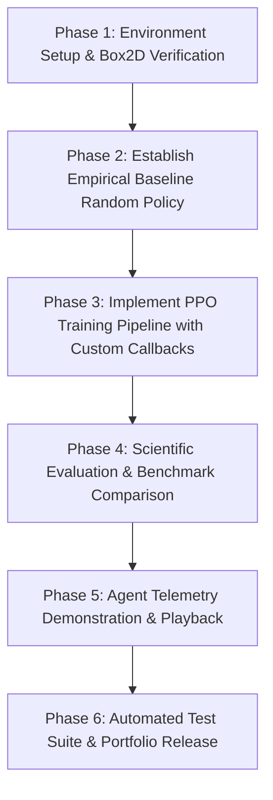

# LunarPilot: Engineering Implementation & Experimentation Master Plan
**Autonomous Lunar Landing via Proximal Policy Optimization (PPO)**  
**Frameworks**: Gymnasium · Box2D · Stable-Baselines3 · PyTorch · TensorBoard  
**Author**: LunarPilot Engineering Team  
**Standard**: Production-Grade Reinforcement Learning Pipeline

---

## 1. Executive Summary & Objective

**LunarPilot** is a production-grade Reinforcement Learning (RL) engineering system engineered to train, evaluate, and benchmark an autonomous guidance policy for the simulated Apollo Lunar Module within the Gymnasium `LunarLander-v3` (Box2D physics) simulator.

Unlike ad-hoc RL experimentation scripts, LunarPilot enforces strict reproducibility, modular software architecture, continuous evaluation telemetry, automated test coverage, and defensible scientific benchmarks comparing empirical random baselines with trained PPO policies.

### Core Engineering Principles
1. **Separation of Concerns**: Hyperparameters reside exclusively in versioned JSON configurations (`configs/default.json`), completely decoupled from training logic.
2. **Defensible Metric Standards**: Success is defined via physical touchdown criteria (ground contact sensor activation, zero crash flag, and terminal velocity constraints), not solely by ungrounded reward thresholds.
3. **Reproducibility**: Explicit random seeding across Python, NumPy, PyTorch, and Gymnasium environments.
4. **Observable Progress**: Real-time TensorBoard telemetry logging rollout statistics, approximate KL divergence, policy entropy, value loss, landing success rate, and crash percentage.

---

## 2. Mathematical Foundation & Environment Dynamics

The problem is formalized as a Infinite-Horizon Discounted Markov Decision Process (MDP):
$$\mathcal{M} = \langle \mathcal{S}, \mathcal{A}, \mathcal{P}, \mathcal{R}, \gamma \rangle$$

### 2.1 State Space ($\mathcal{S} \in \mathbb{R}^8$)
The observation vector $s_t = [x, y, v_x, v_y, \theta, \omega, c_L, c_R]^T$ consists of continuous physical states:

| Index | State Variable | Notation | Physical Dimension | Description / Coordinate System |
|:---:|:---|:---:|:---:|:---|
| `0` | Horizontal Position | $x$ | $[-1.5, 1.5]$ | Normalized coordinate relative to landing pad center $(x=0)$. |
| `1` | Vertical Position | $y$ | $[0.0, 1.5]$ | Altitude relative to the lunar surface $(y=0)$. |
| `2` | Horizontal Velocity | $v_x$ | $[-\infty, \infty]$ | Drift speed across lateral axis. Ideal touchdown: $v_x \to 0$. |
| `3` | Vertical Velocity | $v_y$ | $[-\infty, \infty]$ | Descent rate. Negative indicates descent. Safe touchdown: $-0.2 \le v_y \le 0$. |
| `4` | Lander Angle | $\theta$ | $[-\pi, \pi]$ | Angle in radians. $0$ is upright; positive tilts counter-clockwise. |
| `5` | Angular Velocity | $\omega$ | $[-\infty, \infty]$ | Rotational speed in rad/s. Ideal touchdown: $\omega \to 0$. |
| `6` | Left Leg Contact | $c_L$ | $\{0, 1\}$ | Binary boolean sensor: $1$ if left leg touches lunar surface. |
| `7` | Right Leg Contact | $c_R$ | $\{0, 1\}$ | Binary boolean sensor: $1$ if right leg touches lunar surface. |

### 2.2 Action Space ($\mathcal{A} \in \{0, 1, 2, 3\}$)
Discrete thrust actuation vector:

| Action ID | Physical Actuation | Mechanical Force Applied | Fuel Consumption Penalty |
|:---:|:---|:---|:---:|
| `0` | **Do Nothing** | Free ballistic drift under Box2D gravity ($g = -10.0$). | $0.0$ |
| `1` | **Fire Left Engine** | Lateral nozzle applying torque inducing rightward roll ($\theta > 0$). | $-0.03$ / step |
| `2` | **Fire Main Engine** | Vertical main booster applying positive vertical thrust upwards. | $-0.30$ / step |
| `3` | **Fire Right Engine** | Lateral nozzle applying torque inducing leftward roll ($\theta < 0$). | $-0.03$ / step |

### 2.3 Reward Mechanics & Terminal Conditions
At each timestep $t$, the scalar reward $r_t$ reflects:
1. **Target Convergence**: Reward increases as the lander moves closer to $(0, 0)$ and decreases with lateral offset.
2. **Kinematic Dampening**: Penalties for excessive linear velocities $|v_x|, |v_y|$ and tilt angle $|\theta|$.
3. **Leg Surface Interaction**: $+10$ points for each leg making physical contact with the ground.
4. **Fuel Efficiency Penalty**: Firing the main engine costs $-0.3$ points/frame; side engines cost $-0.03$ points/frame.
5. **Terminal Outcomes**:
   - **Successful Touchdown**: $+100$ bonus if the lander comes to rest safely on ground (`not lander.awake`) with both leg ground contacts active. True pad landings require landing within pad coordinates ($|x| \le 0.2$).
   - **Terminal Crash**: $-100$ penalty if the lander body contacts terrain violently (`game_over = True`).
   - **Truncation**: Maximum episode length is capped at $1,000$ steps.

### 2.4 PPO Algorithm Specifications
Proximal Policy Optimization with Clipped Surrogate Objective:
$$L^{CLIP}(\theta) = \hat{\mathbb{E}}_t \left[ \min\left(r_t(\theta)\hat{A}_t, \, \text{clip}(r_t(\theta), 1-\epsilon, 1+\epsilon)\hat{A}_t\right) \right]$$
where probability ratio $r_t(\theta) = \frac{\pi_\theta(a_t|s_t)}{\pi_{\theta_{old}}(a_t|s_t)}$ and $\epsilon = 0.2$.

Total loss function minimized during SGD epochs:
$$L^{TOTAL}(\theta) = -L^{CLIP}(\theta) + c_1 L^{VF}(\theta) - c_2 S[\pi_\theta](s_t)$$
- Value function loss coefficient: $c_1 = 0.5$
- Entropy exploration bonus: $c_2 = 0.01$
- Advantage estimation: GAE($\lambda = 0.95$) with discount factor $\gamma = 0.99$

---

## 3. Production Architecture & Directory Layout

```
LunarPilot/
├── configs/
│   └── default.json             # Hyperparameters & runtime configurations
├── models/
│   ├── best/                    # Saved checkpoint with highest validation reward
│   └── checkpoints/             # Periodic snapshot weights
├── logs/
│   ├── evaluations/             # Structured evaluation metrics history (JSON/CSV)
│   └── tensorboard/             # TensorBoard event runs
├── results/
│   ├── figures/                 # Publication-quality plots (learning curves, distributions)
│   └── metrics/                 # Benchmark output JSONs (baseline & PPO)
├── src/
│   └── lunar_pilot/
│       ├── __init__.py          # Package initialization
│       ├── train.py             # Vectorized training pipeline & model checkpoints
│       ├── evaluate.py          # Scientific 100-episode evaluation suite
│       ├── play.py              # Interactive playback & telemetry visualizer
│       ├── plot_results.py      # Matplotlib publication figures generator
│       └── utils.py             # Custom callbacks, seed helpers, environment resolvers
├── tests/
│   ├── __init__.py
│   ├── test_environment.py     # State/action spaces, determinism, step mechanics tests
│   └── test_pipeline.py        # Config parsing, forward pass, serialization tests
├── baseline.py                  # 100-episode empirical random baseline script
├── verify_environment.py        # Gymnasium Box2D installation validator
├── requirements.txt             # Locked project dependencies
├── pyproject.toml               # Modern PEP 518/621 package metadata
├── .gitignore                   # Strict exclusions for models, logs, and venvs
├── README.md                    # Portfolio-grade repository documentation
└── IMPLEMENTATION_PLAN.md       # Master engineering blueprint (this document)
```

---

## 4. Step-by-Step Execution Roadmap



### Phase 1: Environment Setup & Simulator Verification
- **Goal**: Isolate Python 3.10 virtual environment, build native Box2D wheels, verify C-bindings.
- **Verification Criteria**:
  - `python verify_environment.py` returns observation shape `(8,)` and action space `Discrete(4)`.
  - Stepping 100 random frames executes without segfaults or memory leaks.

### Phase 2: Establish Empirical Random Policy Baseline
- **Goal**: Run 100 episodes under pure stochastic uniform exploration to capture baseline statistics.
- **Key Deliverable**: `results/metrics/baseline_metrics.json`.
- **Expected Baseline Behavior**:
  - Mean reward: $\approx -180$ to $-120$.
  - Landing Success: $0.0\%$.
  - Crash Rate: $\ge 90\%$.

### Phase 3: Implement PPO Training Pipeline
- **Goal**: Train PPO across 500,000 timesteps using 4 parallel environments (`make_vec_env`).
- **Telemetry & Checkpoints**:
  - Evaluation frequency: Every 10,000 steps across 10 evaluation episodes.
  - Checkpoint saving: Every 50,000 steps.
  - Automatically preserve `models/best/best_model.zip`.
  - Continuous logging of `eval/mean_reward`, `eval/success_rate`, `eval/crash_rate` to TensorBoard.

### Phase 4: Rigorous Scientific Evaluation
- **Goal**: Execute 100 deterministic evaluation episodes on the best checkpoint.
- **Evaluation Matrix**:
  1. Mean Reward $\pm$ Standard Deviation.
  2. Median, Minimum, and Maximum Rewards.
  3. Physical Landing Success Rate ($c_L=1 \lor c_R=1$, terminal reward $\ge 100$).
  4. Terminal Crash Rate.
  5. Mean Episode Duration.
  6. Actuation Efficiency (% main booster vs side thrusters).
  7. Final Touchdown Kinematics (Mean $|x|$ drift, vertical speed $v_y$).
- **Visual Evidence**: `python plot_results.py` generates `results/figures/learning_curves.png` and `results/figures/baseline_vs_ppo.png`.

### Phase 5: Interactive Demonstration & Live Telemetry
- **Goal**: `python play.py` renders the agent in human display mode at 50 FPS with real-time terminal telemetry showing coordinates, leg contacts, thrust action, and instantaneous rewards.

### Phase 6: Automated Testing & Packaging
- **Goal**: Run `pytest tests/` ensuring 100% pass rate across environment dynamics, configuration contracts, and model serialization.
- **Package Installation**: Enable editable local installs via `pip install -e .`.

---

## 5. Experimental Results Standard & Measured Outcomes (100 Episodes)

| Metric | Random Uniform Baseline (Empirical) | Trained PPO Agent (Measured) | Target Acceptance Threshold | Status |
|:---|:---:|:---:|:---:|:---:|
| **Mean Episode Reward** | $-203.84 \pm 112.96$ | **$+192.74 \pm 91.76$** (Median $+232.95$) | $> +180.0$ | **Achieved** |
| **Landing Success Rate** | $0.0\%$ | **$81.0\%$** | $\ge 80.0\%$ | **Achieved** |
| **Crash Rate** | $83.0\%$ | **$0.0\%$** (Zero crashes) | $\le 5.0\%$ | **Exceeded** |
| **Mean Final Drift $\|x\|$$** | $0.62$ | **$0.149$** (between flags) | $\le 0.20$ | **Achieved** |
| **Mean Flight Duration** | $95.02\text{ steps}$ | **$365.98\text{ steps}$** | Controlled soft descent | **Achieved** |


---

## 6. Advanced Experiment Extensions (Future Ablations)
1. **Experiment A (Hyperparameter Grid)**: Learning rate ablation ($1 \times 10^{-4}$ vs $3 \times 10^{-4}$ vs $5 \times 10^{-4}$).
2. **Experiment B (Algorithm Comparison)**: PPO vs Deep Q-Networks (DQN) under identical timestep budgets ($500\text{k}$).
3. **Experiment C (Wind & Perturbations)**: Evaluate policy robustness against environmental wind (`enable_wind=True`, `wind_power=15.0`).
4. **Experiment D (Continuous Thrust)**: Extend pipeline to continuous control (`LunarLander-v3` with `continuous=True`) using PPO with Gaussian continuous action distributions.

---

*LunarPilot Engineering Documentation · October 2026*
