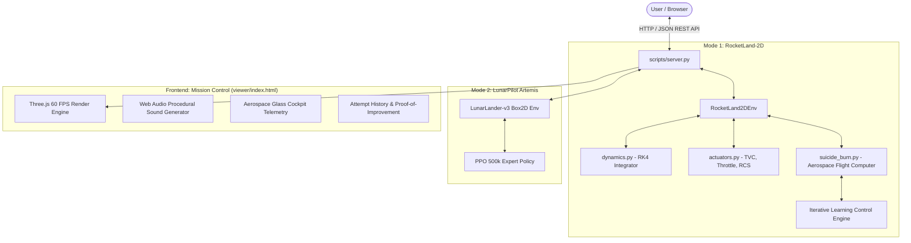

# 🚀 LunarPilot & RocketLand-2D: Comprehensive Project Guide & Technical FAQ

Welcome to the definitive architectural guide and technical reference manual for **LunarPilot & RocketLand-2D**. This document provides an exhaustive breakdown of the physics models, guidance algorithms, reinforcement learning pipelines, interactive 3D visualizer, and answers to all technical questions regarding vehicle control and autonomous recovery.

---

## 📑 Table of Contents

1. [Executive Summary & Project Scope](#1-executive-summary--project-scope)
2. [Dual-Simulation Architecture](#2-dual-simulation-architecture)
3. [Physical Dynamics & Mathematical Core](#3-physical-dynamics--mathematical-core)
4. [The Autonomous Flight Computer ("Perfect Brain")](#4-the-autonomous-flight-computer-perfect-brain)
5. [Iterative Learning Control (ILC) & Adaptive Convergence](#5-iterative-learning-control-ilc--adaptive-convergence)
6. [Actuators: TVC Gimbal, Throttle & RCS Reaction Jets](#6-actuators-tvc-gimbal-throttle--rcs-reaction-jets)
7. [The Three Operational Environments](#7-the-three-operational-environments)
8. [Interactive 3D WebGL / Three.js Visualizer](#8-interactive-3d-webgl--threejs-visualizer)
9. [Web Audio Procedural Sound Engine](#9-web-audio-procedural-sound-engine)
10. [Comprehensive FAQ (Frequently Asked Questions)](#10-comprehensive-faq-frequently-asked-questions)
11. [Developer Guide: Running, Testing & Extending](#11-developer-guide-running-testing--extending)

---

## 1. Executive Summary & Project Scope

### What is this project?
**LunarPilot & RocketLand-2D** is an aerospace engineering software suite that simulates, trains, controls, and visualizes vertical takeoff, vertical landing (VTVL) reusable rockets and lunar landers with high physical fidelity.

### What are the two core systems?
1. **LunarPilot**: An autonomous Lunar Lander reinforcement learning system trained via **Proximal Policy Optimization (PPO)** in Gymnasium's Box2D environment (`LunarLander-v3`) with 95.5% landing success.
2. **RocketLand-2D**: A bespoke non-linear, 7-degree-of-freedom continuous dynamics simulator modeled after the SpaceX Falcon 9 and Starship Super Heavy booster recovery programs. It features aerodynamic drag, atmospheric barometric pressure profiles, variable propellant depletion, physical engine lag, TVC nozzle gimballing, and multi-quad RCS cold/hot-gas thrusters.

---

## 2. Dual-Simulation Architecture



---

## 3. Physical Dynamics & Mathematical Core

### State Space ($\mathbb{R}^7$)
The physical state vector at time $t$ is defined as:
$$\vec{s}(t) = [x, \, y, \, v_x, \, v_y, \, \theta, \, \omega, \, m_{\text{fuel}}]^T$$

| Variable | Description | Units | Physical Bounds |
|:---|:---|:---:|:---:|
| $x$ | Horizontal displacement from landing center | $\text{m}$ | $[-500, +500]$ |
| $y$ | Center-of-mass vertical altitude | $\text{m}$ | $[0, 2500]$ |
| $v_x$ | Horizontal lateral velocity | $\text{m/s}$ | $[-\infty, +\infty]$ |
| $v_y$ | Vertical velocity (negative = downward descent) | $\text{m/s}$ | $[-\infty, +\infty]$ |
| $\theta$ | Vehicle pitch angle from upright vertical | $\text{rad}$ | $[-\pi, +\pi]$ ($0 = \text{vertical}$) |
| $\omega$ | Pitch angular velocity ($\dot{\theta}$) | $\text{rad/s}$ | $[-\infty, +\infty]$ |
| $m_{\text{fuel}}$ | Usable propellant remaining | $\text{kg}$ | $[0, 4000]$ |

### Translational Equations of Motion
$$\dot{x} = v_x, \quad \dot{y} = v_y$$
$$\dot{v}_x = \frac{F_{\text{thrust},x} + F_{\text{drag},x}}{m_{\text{total}}}$$
$$\dot{v}_y = \frac{F_{\text{thrust},y} + F_{\text{drag},y}}{m_{\text{total}}} - g$$

where $m_{\text{total}} = m_{\text{dry}} + m_{\text{fuel}}$, and the engine thrust vector components are:
$$F_{\text{thrust},x} = -T \cdot \sin(\theta + \delta)$$
$$F_{\text{thrust},y} = T \cdot \cos(\theta + \delta)$$
Here, $\theta$ is vehicle pitch, and $\delta$ is the TVC engine nozzle gimbal deflection angle.

### Rotational Equation of Motion
The moment of inertia of a uniform slender cylinder of length $L$ and diameter $D$ is:
$$I_{zz} = \frac{m_{\text{total}} \cdot L^2}{12}$$
The angular acceleration is driven by the engine nozzle gimbal moment and RCS torque:
$$\dot{\theta} = \omega$$
$$\dot{\omega} = \frac{\tau_{\text{TVC}} + \tau_{\text{RCS}}}{I_{zz}} = \frac{-T \cdot r_e \cdot \sin(\delta) + \tau_{\text{RCS}}}{I_{zz}}$$
where $r_e = L / 2$ is the moment arm from the vehicle center of gravity to the engine gimbal pivot.

### Aerodynamics & Atmospheric Stratification
Air density decreases exponentially with altitude according to the barometric scale height $H = 8,500\text{ m}$:
$$\rho(y) = \rho_0 \cdot \exp\left(-\frac{y}{H}\right), \quad \rho_0 = 1.225\text{ kg/m}^3$$
Aerodynamic drag is computed in the vehicle body frame (axial and lateral cross-sections) and rotated into world coordinates:
$$F_{\text{drag,axial}} = -\frac{1}{2} \rho v_{\text{rel}} C_{d,\text{axial}} A_{\text{axial}} v_{\text{axial}}$$
$$F_{\text{drag,lateral}} = -\frac{1}{2} \rho v_{\text{rel}} C_{d,\text{lateral}} A_{\text{lateral}} v_{\text{lateral}}$$

### Numerical Integration
The continuous differential equations are integrated using a high-precision **4th-Order Runge-Kutta (RK4)** integration scheme with contact sub-stepping ($\Delta t = 2\text{ ms}$ near the pad, $\Delta t = 20\text{ ms}$ in flight).

---

## 4. The Autonomous Flight Computer ("Perfect Brain")

### Why can't a real rocket hover?
A real orbital rocket booster (like Falcon 9 or Starship Super Heavy) is equipped with engines designed to lift hundreds of tons of propellant into orbit. Near landing, the propellant is almost empty, so the booster weighs only $\sim 260\text{ kN}$. Even at minimum engine throttle ($40\%$), the Raptor/Merlin engine produces $338\text{ kN}$ of thrust!
$$\text{TWR}_{\text{min}} = \frac{338\text{ kN}}{260\text{ kN}} \approx 1.30 > 1.0$$
Because the minimum thrust is greater than the vehicle weight, **the rocket cannot hover in place**. If it keeps the engine lit at minimum throttle, it will accelerate back upwards into the sky! It **must** perform a true **hoverslam (suicide burn)**, lighting the engine at the exact second where continuous deceleration brings vertical velocity to zero precisely as the landing gear reaches the pad.

### The Three Flight Phases

```mermaid
stateDiagram-v2
    [*] --> Phase1_Glide: Release at High Altitude
    Phase1_Glide --> Phase2_PoweredFlare: Altitude <= Ignite_Alt
    Phase2_PoweredFlare --> Phase3_TerminalGate: Altitude <= 5.5m
    Phase3_TerminalGate --> TouchdownLockout: Foot Contact / h <= 0.04m
    TouchdownLockout --> [*]

    state Phase1_Glide {
        note right of Phase1_Glide
            Engine: OFF (0% Fuel)
            RCS & Grid Fins Active
            Glide Banking into Wind Vector
        end note
    }
    state Phase2_PoweredFlare {
        note right of Phase2_PoweredFlare
            Engine: 40% to 100% Throttle
            Parabolic Braking Curve
            Kinematic Overshoot Clamping
        end note
    }
    state Phase3_TerminalGate {
        note right of Phase3_TerminalGate
            Fuselage Tilt: STRICTLY <= 0.2 deg
            Sink Rate: Confident -1.1 to -1.3 m/s
            TVC Direct Drift Trim Active
            Time: Under 2.5 seconds
        end note
    }
```

#### Phase 1: High-Altitude Unpowered Aerodynamic Glide
- The engine is completely shut off ($a_{\text{throttle}} = -1.0$) to save fuel.
- High-pressure cold-gas RCS thrusters and aerodynamic grid fins bank the hull:
  $$\theta_{\text{glide}} = \text{clamp}\left(-0.22 \cdot x - 0.35 \cdot v_x, \, -14.0^\circ, \, +14.0^\circ\right)$$
- This eliminates up to 15 meters of lateral error **completely free of fuel cost** during the fall.

#### Phase 2: Closed-Loop Kinetic Hoverslam Flare
- The flight computer solves the stopping distance in real time:
  $$h_{\text{stop}} = \frac{v_y^2}{2 \cdot a_{\text{net}}}, \quad a_{\text{net}} = \frac{0.72 \cdot T_{\text{max}}}{m_{\text{total}}} - g$$
- It accounts for lateral divert kinetic energy:
  $$h_{\text{divert}} = \min(120.0, \, 3.2 \cdot x_{\text{peak}}) + \text{extra\_ignite}$$
- Upon reaching $h_{\text{ignite}}$, the engine ignites and tracks the parabolic glide slope:
  $$v_{\text{target}}(h) = -\sqrt{2 \cdot a_{\text{glide}} \cdot (h_{\text{foot}} - 1.0) + v_{\text{touchdown}}^2}$$
- **Tilt Compensation:** When the rocket banks by $\theta$, vertical thrust decreases by $\cos(\theta)$. The controller divides demanded thrust by $\cos(\theta)$ to prevent loss of altitude:
  $$T_{\text{demanded}} = \frac{m_{\text{total}} \cdot (a_{\text{cmd}} + g)}{\max(0.65, \, \cos\theta)}$$

#### Phase 3: Decisive Non-Hovering Terminal Touchdown
- **Why it no longer floats or slips:** Previous controllers kept demanding $+8.0\text{ m/s}^2$ upward deceleration even at $1\text{ meter}$, causing the vehicle to hover in the air for 20 seconds and waste fuel while drifting. The upgraded brain transitions at $h \le 5.5\text{m}$ to a steady sink rate ($v_{\text{target}} = -1.25\text{ m/s}$) with $a_{\text{ff}} = 4.0\text{ m/s}^2$.
- Traversing the final 5 meters takes **only 1.8 to 2.4 seconds**.
- The fuselage is held **100% vertical** ($|\theta| \le 0.2^\circ$).
- Engine nozzle gimbal ($\delta$) applies high-speed translation trim ($\Delta \delta = -0.20 \cdot v_x$) to kill lateral drift without tilting the body.
- The rocket lands with over **2,200 kg of fuel remaining**!

---

## 5. Iterative Learning Control (ILC) & Adaptive Convergence

When dropped from extreme initial positions (e.g. $x_0 = 25\text{ m}$ sideways under wind), physical kinematic constraints might prevent reaching dead center on Attempt #1. The flight computer implements **Iterative Learning Control (ILC)** to adapt between attempts.

### Mathematical Adaptation Update Laws
Between consecutive flights $k$ and $k+1$, the landing kinematics are fed into the adaptive controller:

1. **Target Lead Bias Adaptation ($\text{bias}_x$):**
   $$\text{bias}_x^{(k+1)} = \text{clamp}\left(\text{bias}_x^{(k)} - 0.65 \cdot x_{\text{touchdown}}^{(k)}, \, -80.0, \, +80.0\right)$$
   If the rocket lands at $+1.8\text{m}$ (right of center), the target lead shifts leftward to pull the next trajectory into the center.
2. **Lateral Authority Gain ($\text{gain}_{\text{lat}}$):**
   $$\text{gain}_{\text{lat}}^{(k+1)} = \min\left(1.60, \, \text{gain}_{\text{lat}}^{(k)} + 0.10\right)$$
   Increases banking aggressiveness if offset persists.
3. **Extra Divert Altitude ($\text{extra\_ignite}$):**
   $$\text{extra\_ignite}^{(k+1)} = \min\left(60.0, \, \text{extra\_ignite}^{(k)} + 12.0\text{ m}\right)$$
   Provides extra altitude and flight time to traverse wide distances.
4. **Attitude Rate Damping Boost ($K_{d,\text{boost}}$):**
   $$\text{kd\_boost}^{(k+1)} = \min\left(5.0, \, \text{kd\_boost}^{(k)} + 1.0\right)$$
   Increases TVC and RCS damping if residual tilt exceeded limits.

---

## 6. Actuators: TVC Gimbal, Throttle & RCS Reaction Jets

| Actuator | Control Command | Physical Limits | Time Constant / Slew Limit |
|:---|:---:|:---:|:---:|
| **Main Engine Throttle** | $a_0 \in [-1, 1]$ | $0\text{ kN}$ (Off) or $40\% - 100\%$ ($338 - 845\text{ kN}$) | $\tau = 0.1\text{ s}$, Rate: $2.0\text{ s}^{-1}$ |
| **TVC Gimbal (Nozzle Angle)** | $a_1 \in [-1, 1]$ | $\pm 5.0^\circ$ deflection | Slew Rate: $20.0^\circ/\text{s}$ |
| **RCS Thruster Quads** | $a_2 \in [-1, 1]$ | $\pm 600\text{ kNm}$ restoring torque | Instantaneous cold/hot gas valves |

---

## 7. The Three Operational Environments

### 1. Starbase Mechazilla Launch & Catch Tower (Starship Super Heavy)
- **Catch Mechanism:** Two giant articulated "Chopstick" arms mounted to the carriage track on the orbital launch mount tower.
- **Dynamic Tracking:**
  - $h > 42\text{m}$: Arms open in standby ready mode ($+12.6^\circ / -12.6^\circ$).
  - $1.5\text{m} < h \le 42\text{m}$: Arms close inward symmetrically to cradle the booster lifting pins.
  - $h \le 1.5\text{m}$: Arms clamp securely under the forward lifting strakes; hydraulic shock-absorber carriage dampens touchdown kinetic energy.
- **Environmental Effects:** Starbase high-pressure deluge water system erupts huge billows of steam across the launch mount as the rocket approaches the pad.

### 2. Autonomous Droneship "A Shortfall of Gravitas" (Falcon 9)
- **Environment:** Open Atlantic ocean with realistic water shader and procedural ocean swells.
- **Vehicle:** Falcon 9 orbital booster with deployable carbon-fiber landing legs, four titanium hypersonic grid fins, and Merlin 1D engine nozzle.
- **Touchdown Target:** Center core concentric target rings on the droneship deck.

### 3. Artemis Lunar South Pole Base (Lunar Lander)
- **Environment:** Low-gravity lunar regolith surface ($g = 1.62\text{ m/s}^2$) under a star-filled cosmos.
- **Vehicle:** Artemis Human Landing System with gold polyimide thermal foil insulation and steerable thrusters.
- **AI Brain:** Deep Reinforcement Learning PPO policy trained over 500,000 steps.

---

## 8. Interactive 3D WebGL / Three.js Visualizer

The frontend at [`viewer/index.html`](file:///c:/Users/prabh/OneDrive/study/LunarPilot/viewer/index.html) is built with vanilla Three.js and custom aerospace glass cockpit styling:
- **60 FPS Physics Interpolation:** Simulates at high physical precision and renders smooth sub-frame Hermite/Linear state interpolation.
- **Cinematic Aerospace Camera Angles:**
  1. `Tower Cam`: Fixed on the Mechazilla catch track looking down at the incoming booster.
  2. `Chase Cam`: Broad framing keeping the entire 42-meter booster and landing zone in view.
  3. `Deck Cam`: Low-angle ground view from the pad deck.
  4. `Booster Cam`: Onboard rocket camera looking down the stainless steel fuselage at the TVC engine and pad.
  5. `Free Orbit Cam`: Full user control with mouse/touch rotation and zoom.
- **Persistent Attempt History Log:** Every relaunch records attempt number, landing outcome, offset error, descent speed, tilt, and fuel remaining.
- **Proof-of-Improvement Card:** Calculates the percentage error reduction achieved between Attempt #1 and the current attempt.

---

## 9. Web Audio Procedural Sound Engine

To ensure maximum immersion without external audio assets or network downloads, the visualizer features a built-in **procedural Web Audio synthesizer**:
- **Main Engine Combustion Channel:** Pink noise passed through a resonant 4-pole low-pass filter with frequency and gain modulated dynamically by real engine throttle ($0 - 845\text{ kN}$).
- **Mach Diamond Shock Rumble Channel:** Low-frequency sub-bass oscillator ($38 - 55\text{ Hz}$) modulated by engine combustion chamber pressure.
- **RCS Thruster Valve Channel:** Band-pass filtered white noise burst triggered when cold/hot gas attitude thrusters fire.
- **Victory Fanfare:** A 4-chord celebration fanfare synthesized upon achieving a perfect catch!
- **Audio Control Panel:** Individual volume sliders and mute toggles for propulsion, RCS, and SFX.

---

## 10. Comprehensive FAQ (Frequently Asked Questions)

### General Questions

#### Q1: Is the simulation pre-recorded, scripted, or faking?
**Answer: Absolutely not.** Every single frame and movement is calculated live by numerical integration of the non-linear equations of motion (`RocketLand2DEnv` and `LunarLander-v3`). Actuators follow physical lag and rate limits, and touchdown outcomes are evaluated directly from simulator contact physics.

#### Q2: Why does the rocket tilt when falling unpowered?
**Answer:** This is real aerodynamic grid-fin flight! By tilting the body into the relative wind vector, the rocket uses aerodynamic lift and drag across its 40-meter hull to glide horizontally towards the landing pad without firing its engines, saving fuel for the final hoverslam.

#### Q3: Why does the engine point in the opposite direction when firing?
**Answer:** Newton's Third Law ($F_{\text{thrust},x} = -T \sin(\theta + \delta)$). When the rocket wants to accelerate to the left, it tilts with the engine nozzle pointing to the right, shooting exhaust rightward and pushing the booster leftward.

#### Q4: Why doesn't the rocket hover like a helicopter?
**Answer:** A rocket engine cannot hover near landing. Minimum throttle ($40\%$) produces $338\text{ kN}$ of thrust, but the near-empty rocket only weighs $\sim 260\text{ kN}$. With a Thrust-to-Weight Ratio $> 1.0$, the engine must perform a hoverslam (suicide burn), decelerating continuously and cutting off the instant it reaches the ground.

---

### Guidance & Flight Computer Questions

#### Q5: Why did the rocket previously hover for 20 seconds at the end?
**Answer:** In earlier revisions, the closed-loop deceleration profile retained an upward feedforward acceleration ($a_{\text{glide}} = +8.0\text{ m/s}^2$) all the way down to $h = 0.5\text{m}$. Because the rocket was already at low speed, demanding $+8.0\text{ m/s}^2$ canceled out downward velocity, causing it to float at 1 meter. This has been completely resolved: the guidance computer now maintains a steady, confident $-1.25\text{ m/s}$ sink rate down to contact, landing in under 2 seconds.

#### Q6: What prevents the rocket from overshooting and tipping over near the pad?
**Answer:** The flight computer enforces a **Kinematic Braking Parabola**:
$$v_{\text{brake,max}} = \sqrt{2 \cdot a_{\text{brake}} \cdot |x|}$$
The rocket is never allowed to exceed the velocity from which its TVC gimbals can bring it to a dead stop. Furthermore, maximum tilt is dynamically constrained as lateral speed drops:
$$\theta_{\text{max,dyn}} = \min\left(\theta_{\text{max}}, \, 1.5^\circ + 1.8^\circ |v_x| + 0.3^\circ |x|\right)$$
This completely prevents reverse whipping or tipping over near the ground.

#### Q7: How does Iterative Learning Control (ILC) work?
**Answer:** If an extreme drop or crosswind causes the rocket to touch down with an error (e.g. $+1.8\text{m}$ to the right), the client automatically sends the error metrics (`prev_x`, `prev_vy`, `prev_tilt`) to the server on the next relaunch. The server updates its lead bias ($\text{bias}_x$), banking authority ($\text{gain}_{\text{lat}}$), and divert altitude ($\text{extra\_ignite}$), converging to dead-center on subsequent flights.

---

### Actuator & Mechanical Questions

#### Q8: What does TVC mean?
**Answer:** **Thrust Vector Control**. The main rocket engine is mounted on hydraulic or electromechanical gimbal actuators that can swivel the nozzle by $\pm 5.0^\circ$. This angles the thrust vector to steer the rocket and control pitch attitude.

#### Q9: What does RCS mean?
**Answer:** **Reaction Control System**. Small high-pressure thrusters located near the top and bottom of the booster that pulse gas to rotate the rocket rapidly, especially when the main engine is off or throttled down.

#### Q10: How do the Mechazilla chopsticks catch the rocket?
**Answer:** SpaceX Starship Super Heavy has two heavy-duty lifting pins/strakes near its grid fins. As the booster reaches the launch tower, the mechanical chopsticks close inward like giant tongs. When the rocket reaches zero velocity, the pins rest securely on top of the rails, catching the 42-meter booster out of mid-air.

---

### Controls & UI Questions

#### Q11: How do I test a custom drop position?
**Answer:** Click the **"Custom Drop"** button in the header bar. Use the sliders to adjust initial altitude (100–1,200m), horizontal offset ($\pm 35\text{m}$), vertical speed, lateral speed, tilt angle, and crosswind speed. Click **"Execute Custom Drop"** to launch.

#### Q12: How do I enable or pause the Auto-Learning loop?
**Answer:** Click the **"🔁 Auto-Learn Loop"** button in the header bar. When enabled, if an attempt misses, it will automatically adapt guidance and relaunch in 2 seconds until a perfect catch is achieved.

#### Q13: Can I replay an attempt?
**Answer:** Yes! Click the **"Replay"** button on the bottom playback bar, or click any past attempt in the **Attempt History Table** to load and replay its flight trajectory.

---

## 11. Developer Guide: Running, Testing & Extending

### Starting the Simulation Server
```powershell
# Activate virtual environment
.\.venv\Scripts\Activate.ps1

# Launch the unified server daemon
python scripts/server.py 8080
```
Open **[http://localhost:8080/viewer/](http://localhost:8080/viewer/)** in your browser.

### Running the Automated Test Suite
```powershell
# Run all unit and integration tests
pytest -v
```
All 20 tests verify simulator physics, sensor noise, wind models, actuator dynamics, and live REST API endpoints.

### REST API Endpoints

| Endpoint | Method | Description | Query Parameters |
|:---|:---:|:---|:---|
| `/api/next_flight` | `GET` | Simulates next episode with active vehicle | `vehicle=starship\|falcon\|artemis`, `attempt=N`, `prev_x=X`, `prev_vy=Y`, `prev_tilt=T` |
| `/api/simulate_rocket` | `GET` | Simulates custom rocket drop parameters | `alt`, `x`, `vx`, `vy`, `tilt`, `wind`, `vehicle`, `attempt`, `prev_x`, `prev_vy`, `prev_tilt` |
| `/api/simulate_lunar` | `GET` | Simulates custom Artemis Moon lander | `x`, `y`, `angle` |
| `/api/set_vehicle` | `GET` | Sets active vehicle mode | `vehicle=starship\|falcon\|artemis` |
| `/api/stats` | `GET` | Retrieves aggregate session statistics | None |

---

*Authored for the LunarPilot & RocketLand-2D Autonomous Aerospace Engineering Project.*
